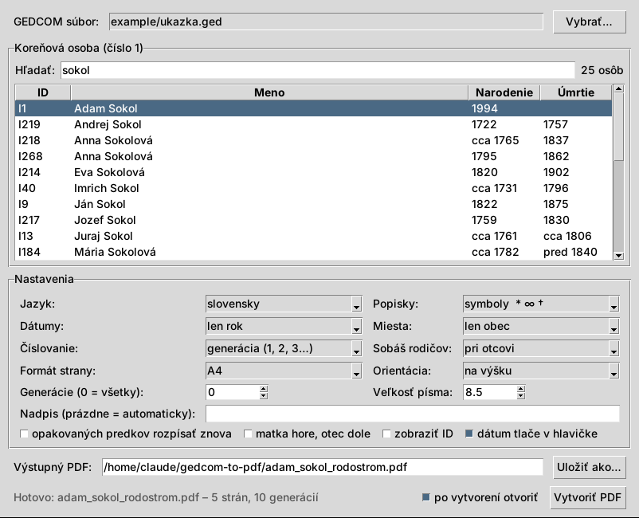

# gedcom-to-pdf (rodostrom)

Generátor PDF schémy predkov (rodostromu) z GEDCOM súboru.
*Ancestor chart PDF generator for GEDCOM files (English summary below).*

Koreňová osoba má číslo 1 a je pri ľavom okraji. Každá ďalšia generácia je
odsadená doprava, otcova línia je nad osobou, matkina pod ňou. Za menom je
v zátvorke rok narodenia (`*`), sobáša rodičov (`∞`) a úmrtia (`†`):

```
            ┌ 3. Pavol Sokol (*1922, †1988)
      ┌ 2. Ondrej Sokol (*1960, ∞1992 (rozv.), †2009)
      │     └ 3. …
1. Adam Sokol (*1994)
      │     ┌ 3. …
      └ 2. …
            └ 3. …
```

Ukážka: [example/ukazka.pdf](example/ukazka.pdf) vygenerované z
[example/ukazka.ged](example/ukazka.ged).

Predok, ktorý sa v strome objaví viackrát (napr. príbuzenské sobáše), sa
rozvinie len raz; pri ďalšom výskyte je odkaz „pozri str. N“.

## Inštalácia

Potrebný je Python 3.9+ a knižnica [reportlab](https://pypi.org/project/reportlab/):

```
pip install -r requirements.txt
```

Skript hľadá TTF písmo s diakritikou automaticky (DejaVu Sans, Liberation Sans,
Arial, Segoe UI na Linuxe, Windows aj macOS). Iné písmo sa dá zadať cez `--font`.

## Grafické okno (GUI)

```
python rodostrom_gui.py
```



Vyberiete GEDCOM súbor, v zozname nájdete a označíte koreňovú osobu,
nastavíte voľby a stlačíte **Vytvoriť PDF** (alebo dvojklik na osobu).
Posledný súbor, osoba a nastavenia sa zapamätajú v `~/.rodostrom_gui.json`.
GUI používa Tkinter, ktorý je súčasťou Pythonu na Windows aj macOS; na Linuxe
ho treba doinštalovať (`sudo apt install python3-tk`).

## Použitie z príkazového riadku

```
# nájdi ID osoby
python rodostrom.py example/ukazka.ged --find "Adam Sokol"

# vygeneruj PDF (osoba podľa ID alebo jednoznačného mena)
python rodostrom.py example/ukazka.ged -p I1
python rodostrom.py example/ukazka.ged -p "Adam Sokol" -o moj_rodostrom.pdf

# s miestami a celými dátumami, len 6 generácií
python rodostrom.py example/ukazka.ged -p I1 --places short --dates full -g 6
```

| Voľba | Význam | Predvolené |
|---|---|---|
| `-p, --person` | koreňová osoba: GEDCOM ID (`I1`) alebo časť mena | povinné |
| `-o, --output` | výstupný PDF | `<meno>_rodostrom.pdf` |
| `--find TEXT` | vypíše osoby, ktorých meno obsahuje TEXT (bez ohľadu na diakritiku) | |
| `-g, --generations N` | maximálny počet generácií vrátane koreňa (0 = všetky) | 0 |
| `--lang sk\|cs\|en` | jazyk nadpisu, skratiek a čísel strán | `sk` |
| `--labels symbols\|abbr` | `* ∞ †` alebo `nar. sob. zom.` | `symbols` |
| `--dates year\|full` | len rok, alebo celý dátum (`14.5.1991`) | `year` |
| `--places none\|short\|full` | bez miest, len obec, alebo celé miesto | `none` |
| `--numbering generation\|ahnentafel\|none` | číslo generácie (1, 2, 3…) alebo Kekulé číslo (otec = 2n, matka = 2n+1) | `generation` |
| `--marriage-on father\|both\|none` | pri ktorom z rodičov uviesť ich sobáš | `father` |
| `--repeat` | opakovaných predkov rozvinúť znova namiesto odkazu | |
| `--mother-first` | matka hore, otec dole | |
| `--show-ids` | za meno pridať GEDCOM ID | |
| `--no-fallback-events` | nepoužiť krst/pohreb, keď chýba narodenie/úmrtie | |
| `--title`, `--no-date` | vlastný nadpis, bez dátumu tlače | |
| `--page-size a4\|a3\|a5\|letter\|legal`, `--orientation portrait\|landscape` | formát strany | `a4`, `portrait` |
| `--font-size`, `--line-height`, `--indent`, `--margin` | typografia (body) | 8.5, 1.7, auto, 36 |
| `--font cesta.ttf` | vlastné písmo | auto |

Ak sa najdlhší riadok nezmestí na šírku strany, skript najprv zmenší
odsadenie generácií a potom písmo. Pri veľmi dlhých riadkoch (napr. celé
miesta) pomôže `--orientation landscape`, `--page-size a3` alebo `--places short`.

### Poznámky k údajom

- Dátumy GEDCOM `ABT`, `EST`, `CAL` sa zobrazia ako „cca“, `BEF` ako „pred“, `AFT` ako „po“,
  rozsahy `BET … AND …` / `FROM … TO …` ako „1903–1905“.
- Rozvod sa zobrazí („∞1991 (rozv.)“), ak má rodina v GEDCOM-e záznam `1 DIV`.
- Ak osoba nemá narodenie, použije sa krst (`CHR`/`BAPM`), ak nemá úmrtie, použije sa pohreb (`BURI`).

## Testovacie dáta

`example/ukazka.ged` obsahuje **len vymyslené osoby, dátumy a obce**, vygenerované
skriptom `tools/generate_example.py` (náhodne, s pevným seedom). Súbor zámerne
obsahuje chýbajúcich rodičov, približné dátumy (`ABT`, `BEF`), rozvod a
opakovaného predka. Nový súbor s inými dátami:

```
python tools/generate_example.py --seed 42 -g 8 -o example/ukazka.ged
```

`.gitignore` ignoruje všetky ostatné `.ged` a `.pdf` súbory, aby sa do
repozitára omylom nedostal skutočný rodokmeň.

## English summary

`rodostrom.py` turns a GEDCOM file into a multi-page PDF ancestor chart: the
root person is no. 1 on the left, each generation is indented to the right,
father above, mother below, with birth / parents' marriage / death years in
parentheses. Repeated ancestors are printed once and referenced by page.

```
pip install reportlab
python rodostrom.py example/ukazka.ged --find "Sokol"
python rodostrom.py example/ukazka.ged -p I1 --lang en --places short --dates full
```

`example/ukazka.ged` is fictional test data made by `tools/generate_example.py`.
Run `python rodostrom.py -h` for all options, or `python rodostrom_gui.py` for a simple window (Tkinter).

## Licencia

MIT, pozri [LICENSE](LICENSE).
