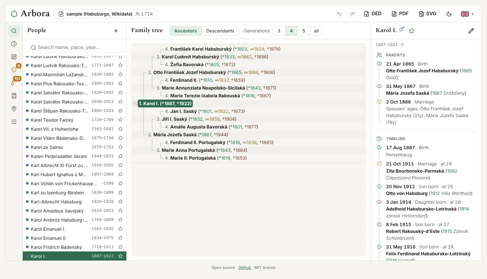
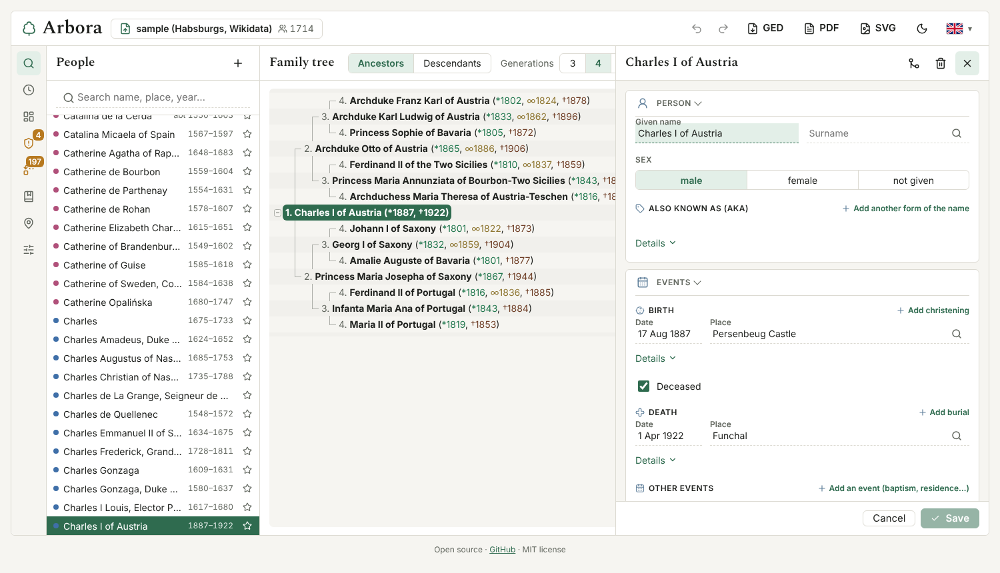

# Arbora

**Online: https://r3mus99.github.io/arbora/**

A web page to explore, check, edit and print a family tree from a GEDCOM file.
Everything runs in your browser; the file is never uploaded anywhere.



## What it does

- **View** the ancestors or descendants of anyone, as a tree you can collapse,
  with a searchable list of people, a timeline of each person, recent people and
  favourites, and a file overview with statistics.
- **Edit** about 40 GEDCOM tags in one edit window: names, events, occupations
  and facts, marriages, children, parents, associations, notes, sources and
  contact details. Add, delete and merge people and families. Everything is one
  undo step, and the parts of the file you do not touch are written back
  byte for byte. Download the result as GEDCOM.
- **Check** the file for broken links, impossible dates and odd surname endings,
  fix what is safe with one click, and unify spelling variants of surnames,
  given names and places in bulk.
- **Browse** every place and every source and note of the file in their own
  lists.
- **Print** the tree as a coloured A4 **PDF** chart, or as a decorative
  **tree poster** in SVG for large-format printing.
- **12 languages**, light and dark mode, and your data stays on your computer.



The screenshots show the built-in sample, the Habsburg family tree from Wikidata
(see [Test data](#test-data)).

## The charts

The on-screen chart and the PDF are laid out the same way.

### Ancestors

The root person is no. 1 at the left edge. Each further generation is indented
to the right, the father's line above the person and the mother's below. After
the name, the years of birth (`*`), the parents' marriage (`∞`) and death (`†`)
are in parentheses:

```
            ┌ 3. Charles Louis of Austria (*1833, ∞1862, †1896)
      ┌ 2. Otto Francis of Austria (*1865, ∞1886, †1906)
      │     └ 3. Maria Annunziata of Bourbon-Two Sicilies (*1843, †1871)
1. Charles I (*1887, †1922)
      │     ┌ 3. George of Saxony (*1832, ∞1859, †1904)
      └ 2. Maria Josepha of Saxony (*1867, †1944)
            └ 3. …
```

Sample: [public/sample_ancestors.pdf](public/sample_ancestors.pdf).

### Descendants

The chosen ancestor is no. 1. Below them is the spouse with the year of
marriage, and below both the children, indented and sorted by birth, then the
grandchildren and so on. With several marriages the children are grouped by the
spouse they had them with:

```
1. Francis I (*1708, †1765)
∞1736 Maria Theresa (*1717, †1780)
   ├ 2. …
   ├ 2. Leopold II (*1747, †1792)
   │  ∞1765 Maria Luisa of Spain (*1745, †1792)
   │     ├ 3. Francis II (*1768, †1835)
   │     │  ∞1788 Elisabeth of Württemberg (*1767, †1790)
   │     │     └ 4. …
   │     │  ∞1790 Maria Theresa of Naples and Sicily (*1772, †1807)
   │     │     ├ 4. Marie Louise of Austria (*1791, †1847)
   │     │     └ 4. Ferdinand I (*1793, †1875)
   │     └ 3. …
   └ 2. …
```

Sample: [public/sample_descendants.pdf](public/sample_descendants.pdf).

A person who appears in the tree more than once (for example after marriages
between relatives) is written out only once; later occurrences refer to it.

## Usage

1. Open the page and choose (or drop) your `.ged` file, or try the built-in
   sample. Then the window shows a top bar, an icon rail on the left, a panel
   next to it, the chart in the middle and the details of a person on the right.
   The top bar has the Arbora title, the open file with the number of people
   (click it or drop a file on it to open another one), undo and redo, three
   downloads (**GED**, **PDF**, **SVG** tree poster), the light/dark switch and
   the language.
2. The icon rail opens one tool at a time: the list of **people** with a search
   by name, place or year; **recent** people and favourites (the star next to a
   name); the **file overview**; the **file check**; the **bulk fix**; the
   **changes** made since the file was opened; **sources and notes**; **places**;
   and **settings**.
3. The **file overview** shows the number of people (men and women), families
   and generations (the longest parent–child line), the years the file covers,
   the oldest ancestor (click to make them no. 1 of the chart), the number of
   problems found by the file check, and the most common surnames and places.
   A surname is a link to the search.
4. The chart is laid out the same way as the PDF. Switch between **Ancestors**
   and **Descendants** and choose the number of generations in **Settings**. At first
   person no. 1 is the one chosen last time, otherwise the first in the file.
5. Clicking a person shows their details on the right, with icons: parents,
   marriages with children, and a timeline of birth, marriages, children,
   occupations, residences, death and burial with the age at each event.
   Relatives are links; the crosshair button makes the person no. 1 of the
   chart and the pencil opens the edit window. Small values (name, sex, date,
   place, religion, occupation, note) can also be changed in place.
6. A repeated ancestor shows a link **see no. X** instead of their branch (with
   Ahnentafel or d'Aboville numbering, otherwise **see above / below**) that
   jumps to the written-out branch and highlights it. The arrows next to the
   title (or Alt+← / Alt+→) go back and forward through the people you viewed.
7. The **−** on the connector before a name collapses that person's branch and
   **+** expands it again; with Shift, the whole generation. The chart and the
   PDF share all settings, so the PDF matches the chart (collapsed branches are
   not carried into the PDF).
8. **PDF** creates the PDF and **SVG** the tree poster; both download at once.

### Editing and GEDCOM export

The pencil in the person's details opens one wide **edit window** over the tree
and the details. It is made of collapsible parts, and the ones that hold data
open by themselves:

- **Person**: given name, surname (surnames from the file are suggested), sex
  and other forms of the name ("also known as", stored as `NAME` with
  `TYPE aka`).
- **Events**: birth, christening, death, burial and any other event
  (residence, baptism, emigration…), each with date, place and, behind
  *Details*, age, cause and agency. Ticking *Deceased* without any details
  stores `1 DEAT Y`.
- **Occupation and facts**: occupations and other attributes, each with its own
  date and place.
- **Family**: every marriage as its own card with date, place, divorce and
  details, the spouse and the children (sorted by birth on request). A new
  child, spouse or parent can be made right there; a child starts with the
  father's surname in the form that fits the child's sex, and a residence can
  copy its place from the parents.
- **Parents and associations**: the kind of relation to each parent and
  associations with other people.
- **Notes and sources**: notes and source citations with page and quality.
- **Other details**: restriction, address, phone, e-mail, web and reference
  numbers.

A person can also be **added**, **deleted** (every pointer to them is cleaned
up) and **merged** with a duplicate, choosing the value on every conflict side
by side. Everything is checked against loops: nobody can become their own
ancestor. Place fields suggest the places already in the file.

A date can be typed as `14.5.1891`, `5/1891`, `1891`, `~1890`, `<1890`, `>1890`,
`1890–1895`, with the "about / before / after" words of the page language, or
directly in GEDCOM form (`ABT 1890`, `14 MAY 1891`). Below the field you see how
the date will be stored. Any other text is stored as a date phrase in
parentheses.

**Save** (Ctrl+Enter) shows the change at once in the chart and the PDF,
**Cancel** (Esc) drops it. Every save is one undo step; the arrows in the top
bar (or Ctrl+Z / Ctrl+Y) undo and redo. The **changes** panel lists the records
that differ from the opened file, and unsaved edits survive a reload.

**Download GEDCOM** downloads the edited file; while there are changes not yet
downloaded, a dot on the button marks "unsaved changes". Changed records are
written anew; every other line stays exactly as it was, including tags Arbora
does not know (`_UID`, coordinates…). Even in a changed record only the edited
lines change. The header records Arbora as the program that saved the file
(`HEAD SOUR ARBORA` with its version) and the date and time of saving
(`HEAD DATE`). The file is saved as UTF-8. Before you leave the page with
unsaved changes, the browser asks. This is tested on generated files with
random edits (add, delete, merge, change, undo, redo).

### File check

The shield button in the top bar shows the number of problems found
(GEDCOM 5.5.1). When there are none it only says so in its tooltip; otherwise a
click lists them, and the names in the list open the person's details. It checks:

- the `HEAD` header and the `TRLR` end of the file, and duplicate IDs;
- links to people or families that are not in the file, and links without a
  link back (`FAMS`/`FAMC` against `HUSB`/`WIFE`/`CHIL`);
- dates not in GEDCOM form (e.g. `1885-12-12`), and sex against the role in a family;
- impossible dates: death before birth, a child born before a parent, a parent
  younger than 12, birth after the mother's death or more than a year after the
  father's. Approximate dates (`ABT`) are compared only when they are years apart;
- surname endings that do not fit the sex, in languages where they differ:
  Slovak and Czech (Horváth / Horváthová, Nový / Nová) and Polish (-ski / -ska),
  only in files that show the habit and only for people with a known sex.

What can be fixed safely has a magic wand on the right; each fix is one step
that can be undone. A missing header or `TRLR` is added, a link to nothing is
removed, a missing link back is added and a date like `1885-12-12` is rewritten
as `12 DEC 1885`, and a surname gets the form that fits the sex when that is certain (Nový → Nová, or a form the file already has). The list closes once everything is fixed.

### Bulk data fix

Its own tool in the icon rail, with **Surnames**, **Given names** and **Places** tabs: spellings of
one name or town that differ only in accents, doubled letters or the old
Hungarian spelling (Pavlovský / Pavlovszký, Kubíček / Kubiček, Lieskovice /
Lieszkovicz) are shown as groups. The most used spelling is offered; click
another one or type your own, use × to leave a spelling out, and **Unify**
renames it in every record as one step that can be undone. For surnames the
old spelling is kept as another name of the person (`1 NAME …` with
`2 TYPE aka`, "also known as") unless you untick that option. The number of
records that change opens a list of them. A man's and a woman's form
(Kováčik / Kováčiková) are never put together. For places only the town, the
first part of the place, is renamed; the district and country stay. A group
that is not the same name can be hidden (the **Hidden** tab shows it again),
and **Batch rename** changes any one spelling to another.

**Privacy:** everything runs only in your browser. The GEDCOM file is not sent
anywhere and the page has no server; you download the edited file yourself. The
browser remembers only the settings and the ID of the last person
(localStorage), never the file's content.

### Language

The language is switched with the flag in the top right: Slovak, Czech, Polish,
Hungarian, German, English, French, Italian, Spanish, Portuguese, Dutch and
Ukrainian. The chosen language applies to the page and to the PDF (title,
abbreviations, date format, page numbers). On the first visit it follows the
browser's language.

### Settings

The first part of the Settings window applies to both the chart and the PDF:

| Option | Choices |
|---|---|
| Labels | symbols `* ∞ †` or abbreviations (`b. m. d.` in English) |
| Dates | year only, or the full date |
| Places | checkbox: show the municipality (first part of the place) |
| Numbering | generation (1, 2, 3…); Ahnentafel for ancestors (father = 2n, mother = 2n+1), d'Aboville for descendants (1.2.1); none |
| Parents' marriage | for ancestors: next to the father, next to both parents, not shown |
| Generations | maximum number including the root (0 = all); the poster draws at most 10 (descendants: 6) |

The dark mode is switched with the moon icon in the top bar; without a choice it follows the system.

**PDF**: the PDF has no settings of its own. It is always A4 and in colour (a printer can scale it to Letter and other papers).
If the longest line does not fit the page width, the generation indent and then the font size
(down to 6 pt) are reduced automatically; only when even that does not fit a portrait page,
the pages turn landscape.

### Tree poster

The **SVG** button in the top bar, next to GED and PDF, downloads the ancestors of the chart's root person as a
decorative wall chart for large-format printing: the person in the middle below the two parents, joined to them by one limb that splits in two, the father's line unfolding to the left and
the mother's to the right, with branches and leaves between the name plates. The plates have exact positions, the
branches are drawn from a seeded random generator, so every download draws a different, unique tree. The poster uses the same number of generations as the chart and the PDF (3 to 10; "all" and anything above 10 draw 10); the title, labels and
dates follow the other settings. The SVG is vector, with the text set in Alkatra and written as outlines, so it prints sharply at any size and looks the same without the font; the poster is as wide as the generations need and as high as the people need: only people who exist take room, so a family with gaps gives a lower poster than a complete tree, the closest generations get bigger plates (the person at 200 %, the parents at 175 %, and so on down to 100 %), and the border and the name are coloured by sex.
With the **Descendants** chart chosen, the same button draws a poster of the descendants instead: the person at the left, every generation a column to the right, each person with the partners beside the plate and the children of each partnership in the next column, one trunk with a branch for each child. It shows at most 6 generations (and at most 500 plates, which is about 5 generations for a typical family; a very large family loses its last generation, the title says how many are drawn). The plates, branches, border and settings are the same as on the ancestors poster; from 5 generations on it also has, under the tree, the ruler of the generations and one list of the places and names of all descendants.
The plan and the open points are in [docs/tree-poster.md](docs/tree-poster.md).

### Notes on the data

- `ABT`, `EST`, `CAL` dates are shown as "about", `BEF` as "before", `AFT` as
  "after" (in the page language), ranges `BET … AND …` / `FROM … TO …` as
  "1903–1905".
- A divorce is shown (a ⚮ after the marriage) when the family has a `1 DIV` line.
- In the chart and the PDF a missing birth falls back to christening
  (`CHR`/`BAPM`) and a missing death to burial (`BURI`/`CREM`).
- File encoding: UTF-8 (with or without BOM), UTF-16, otherwise Windows-1250.

## Structure

The page is written in TypeScript with React and built with Vite. The version history is in [CHANGELOG.md](CHANGELOG.md); design rules for the UI are in [docs/design-guidelines.md](docs/design-guidelines.md).

```
src/core/           core without UI: GEDCOM → chart rows → PDF (pdf-lib + fontkit)
  gedcom.ts         reading GEDCOM (encoding, records, people, families), search
  date.ts           GEDCOM dates: their valid form, years, ISO dates
  edit.ts           editing records, typed dates, writing GEDCOM
  check.ts          file check and safe fixes
  variants.ts       bulk fix: spelling variants of surnames, given names and places
  merge.ts          merging two people; structure.ts / facts.ts / sources.ts: tags, events, citations
  placelist.ts      the list of places; stats.ts: the file overview
  format.ts         options, dates, places, the text of a person's line
  chart.ts          ancestor and descendant chart rows
  collapse.ts       collapsed branches: which rows stay visible
  pdf.ts            page layout and PDF
  poster.ts         tree poster of ancestors: plates, seeded branches and leaves, SVG (posterFont.ts: glyph widths and outlines)
  posterDescendants.ts  tree poster of descendants: columns of persons, partners and children on the same plates and branches
  texts.ts          PDF texts in 12 languages
  *.test.ts         tests on the sample and made-up data
src/ui/             the React page: chart (TreeView), person details (PersonDetail),
                    edit window (EditWindow, PersonEditor), icon-rail tools (people, overview, file check,
                    bulk fix, changes, sources, places, settings), UI translations (i18n.ts) and flags; the logic that
                    needs no DOM is in history.ts (undo, back/forward) and options.ts, with tests
public/             static files: DejaVu Sans and Alkatra fonts, sample GEDCOM and PDFs, licenses
```

Development (Node.js 22):

```
npm install
npm run dev       # http://localhost:5173
npm test          # tests
npm run coverage  # tests with the coverage of the core
npm run lint      # oxlint
npm run build     # the page into dist/
```

GitHub Actions (`.github/workflows/pages.yml`) runs the linter and the tests, builds the page
and deploys it to GitHub Pages on every push to `main`; the repository setting
is *Pages → Source: GitHub Actions*.

## Test data

`public/sample.ged` is the Habsburg family tree from
[Wikidata](https://www.wikidata.org) (CC0): the ancestors of Emperor Charles I
(I1) and the male-line descendants of Francis I of Lorraine (I52) with their
spouses, 1714 people in all. Nobody in it was born in 1950 or later, and from
1900 on only people with a known date of death, so there are no living persons.
Names and places come from the English Wikidata labels, where missing from the
German, Czech or Slovak ones; every person carries their Wikidata ID
(`REFN … TYPE Wikidata`). It has approximate dates, several marriages, a divorce
(e.g. Henry IV, I416), children with an unknown mother and many repeated
ancestors.

`.gitignore` ignores every other `.ged` and `.pdf` file so that a real family
tree does not end up in the repository by mistake.

## License

MIT, see [LICENSE](LICENSE). Third-party libraries and fonts:
[public/LICENSES.md](public/LICENSES.md).
